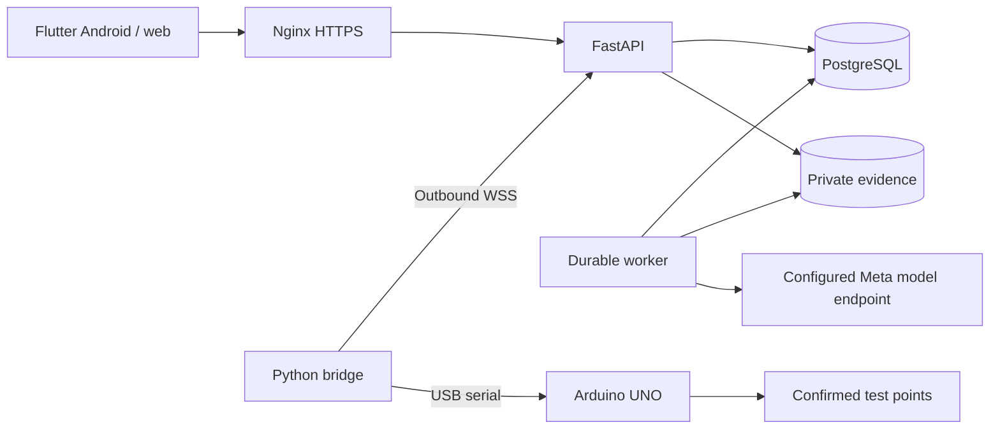

# CircuitLab AI

An evidence-driven assistant for troubleshooting low-voltage electronic circuits.
CircuitLab combines circuit photos, confirmed connections and targeted measurements
to help a person understand a fault, perform a repair and verify the result.

The Android/web laboratory and public landing support **English and Spanish**.
The local preview runs in explicitly labeled simulation mode.

## What it does

- Organizes private investigations for LED/resistor circuits, resistive dividers and analog sensors.
- Combines photographs, confirmed connections and authorized test points with competing fault hypotheses.
- Explains the next useful measurement and the different outcomes predicted by each hypothesis.
- Records manual or instrumented readings, including their source and calibration identifier.
- Keeps the human operator in control of physical changes and checks fresh readings against fixed criteria.
- Exports an investigation as JSON or Markdown and supports authenticated, read-only reviewers.
- Provides account administration, session revocation and password recovery through Resend.
- Retains Android drafts and pending photos/measurements in a local SQLite outbox.
- Optionally creates bilingual Circuit Story summaries linked to the investigation's source records.

## Investigation workflow

1. Describe the intended behavior, observed symptoms and supply voltage.
2. Confirm connections, operating conditions and up to three test points with acceptable voltage ranges.
3. Attach circuit photographs and request analysis. The specification is frozen when analysis starts.
4. Review competing explanations, predicted outcomes and the proposed measurement or clarification.
5. Confirm the measurement conditions and record a manual reading or request an instrument reading.
6. Review the proposed intervention, disconnect power for wiring changes and confirm the action performed.
7. Restore the operating conditions and collect fresh readings for every specified point.
8. Perform the stated functional test, record its observed pass/fail result, then run verification and review the report and event history.

The model proposes diagnostic steps. The backend enforces state transitions and
checks fresh voltage readings and the separately recorded functional observation independently from the model's explanation. A failed or missing functional observation cannot produce a verified repair.

## Technologies and architecture

| Component | Location | Technologies and responsibility |
|---|---|---|
| Laboratory | `apps/client` | Flutter/Dart, Riverpod, GoRouter, Dio, Drift/SQLite and secure token storage; Android and web UI |
| Landing | `apps/landing` | HTML, CSS and JavaScript with English/Spanish catalogs and prerendered pages |
| API and worker | `services/backend` | Python, FastAPI, Pydantic, SQLAlchemy and Alembic; private evidence, accounts and durable diagnostic jobs |
| Database | Configured by `DATABASE_URL` | PostgreSQL for deployment; SQLite for local development with a single worker |
| Inference | `services/backend/app` | Meta-compatible multimodal inference through Meta Model API, Baseten or a self-hosted endpoint |
| Instrument bridge | `services/bridge` | Python, WebSockets and pyserial; outbound connection, USB acquisition and a durable command journal |
| Firmware | `firmware/instrument_node` | Arduino UNO, PlatformIO and ArduinoJson; ADC readings at TP1-TP3 |
| Contracts | `contracts` | Exported OpenAPI and hardware JSON schemas |
| Evaluation | `experiments` | Python harness comparing diagnostic strategies under the same observation budgets |
| Deployment | `infra` | Docker Compose, a backend image and an Nginx HTTPS configuration example |
| Automation | `.github/workflows`, `scripts` | GitHub Actions, pytest, Flutter tests, landing DOM checks and development utilities |



The worker uses leases and execution tokens to reject stale responses without
holding a database transaction during inference. Measurement idempotency keys and
the bridge journal prevent duplicate records and repeated command execution.
Evidence access is restricted to owners and authorized reviewers. Passwords use
scrypt; access, refresh and device credentials are stored as hashes.

## Run locally

Requirements: Python **3.12.10**, uv, Flutter **3.35.6** / Dart **3.9.2**.
Node **22** is needed for landing checks; PlatformIO is needed for firmware.
Dependency versions are recorded in the committed lockfiles.

From `services/backend`, prepare the database and start the API:

```powershell
uv sync --frozen
$env:APP_ENV = 'development'
$env:AI_MODE = 'simulation'
$env:DATABASE_URL = 'sqlite:///./circuitlab.db'
uv run alembic upgrade head
uv run python -m app.manage create-user --email laboratory@example.com --admin --language en
uv run uvicorn app.main:app --host 127.0.0.1 --port 8000
```

In another terminal, from `services/backend`, start the worker with the same settings:

```powershell
$env:APP_ENV = 'development'
$env:AI_MODE = 'simulation'
$env:DATABASE_URL = 'sqlite:///./circuitlab.db'
uv run python -m app.worker
```

From `apps/client`, run the web laboratory:

```powershell
flutter pub get --enforce-lockfile
flutter run -d chrome --web-port 8080 --dart-define=API_BASE_URL=http://localhost:8000/api/v1
```

API documentation: <http://localhost:8000/docs>.
Readiness endpoint: `GET /api/v1/health/ready`.

### Package the landing and laboratory

From the repository root:

```powershell
cd apps/client
flutter build web --base-href /app/ --no-web-resources-cdn --dart-define=API_BASE_URL=http://localhost:8000/api/v1
cd ../..
python scripts/build_site.py
```

Output: `build/site/`. The Spanish landing is at `/`, the English landing at
`/en/`, and the laboratory at `/app/`. Behind an Nginx proxy, build with
`--dart-define=API_BASE_URL=/api/v1` instead of the local absolute URL.

After installing dependencies and packaging the local build, the Windows launcher
starts an isolated simulation database, API, worker and static website:

```powershell
powershell -File scripts/dev.ps1
# Stop the registered development services:
powershell -File scripts/stop-dev.ps1
```

The packaged local website opens at <http://localhost:8080/en/>. Its development
administrator is `demo@circuitlab.local` / `CircuitLab-demo-2026`.
Android emulators use `http://10.0.2.2:8000/api/v1`; physical devices need a reachable
API. Android queues pending photos and measurements; web saving requires connectivity.

## Configuration

Use `.env.example` as the configuration reference. The root `.env` is loaded by
Docker Compose. For direct local runs, export the settings in each terminal or use
`services/backend/.env`, which is loaded from the backend working directory.
Keep the database, storage and inference settings consistent between API and worker.

### Model inference

```dotenv
AI_MODE=meta
META_PROVIDER=meta
META_API_BASE_URL=https://api.meta.ai/v1
META_API_KEY=YOUR_PRIVATE_KEY
META_REASONING_MODEL=YOUR_ENABLED_MODEL_ID
```

Provider profiles are `meta`, `baseten` and `self_hosted`. Baseten uses
`https://inference.baseten.co/v1`; a self-hosted profile uses its configured
compatible endpoint. `META_API_KEY` belongs to the selected inference provider:
use a Baseten key with `META_PROVIDER=baseten`, not a Meta Model API key.
Model identifiers must be available to the configured account.
Each live diagnostic step uses a bounded two-request tool cycle. The model first
calls `get_recorded_observations`; the backend executes this read-only function for
the current authorized investigation and returns its recorded criteria/readings as
a `tool` message. The model then submits a bilingual `submit_diagnosis` result,
which the backend validates before changing session state. This tool cannot query
another session, acquire measurements, execute code or perform repairs.

`META_REASONING_EFFORT=low` bounds reasoning within the response budget. The API key
uses a redacted settings type and is sent only in backend authorization headers.
Every provider exchange and tool execution is audited in PostgreSQL, including
request hashes, receipts, reported model, usage and failures. Permanent provider
errors such as 401/403/404 are not retried automatically. No model fallback is selected.
Meta Model API uses its enabled hosted model IDs, such as `muse-spark-1.3`;
provider-hosted Muse Spark Open requires the corresponding provider's credentials
and exact model ID.

Set `AI_MODE=simulation` for the deterministic development fixture. It performs no
model inference and labels its outputs as simulated. Changing the display language
does not issue a new inference request: model responses retain both translations.

### Accounts and Resend

Administrators create and manage accounts from the laboratory's Users panel.
Role/status changes revoke sessions; deactivation also revokes device credentials.
There is no public registration endpoint.

```dotenv
RECOVERY_DELIVERY=resend
APP_ORIGIN=https://YOUR_DOMAIN
RESEND_API_KEY=YOUR_RESEND_API_KEY
RESEND_FROM="CircuitLab AI <access@YOUR_VERIFIED_DOMAIN>"
```

Resend is the only email provider; `RESEND_API_KEY` is separate from model credentials.
Recovery links are expiring and single-use. Resetting a password revokes existing
sessions. `disabled` turns delivery off; `file` previews messages in development
without sending email. The local launcher defaults to private email files; to exercise Resend,
configure the key and verified sender, then run
`powershell -File scripts/dev.ps1 -RecoveryDelivery resend`.

### Circuit Story

The optional story feature creates a bilingual visual summary after an investigation
reaches `resolved` or `inconclusive`. Its panels reference recorded observations,
measurements, interventions and verification results.

Configure `STORYBOARD_MODE=meta`, `STORYBOARD_API_KEY` and `STORYBOARD_MODEL` with an
available Muse Wonder model. `STORYBOARD_API_KEY` authenticates directly with Meta
Model API and is only needed for real story generation. Leave it empty with
`STORYBOARD_MODE=disabled` when using diagnosis alone. A Baseten diagnostic key does
not authenticate this endpoint. The local launcher can provide a labeled simulation preview.

## Hardware

Investigations support 1–8 authorized test points. The bilingual specification editor
adds and removes point rows without renaming the remaining points; criteria freeze
when analysis starts. Manual readings can use every authorized point. Bridge readings
only offer points supported by an enrolled device; the reference firmware below still
maps three inputs. More investigation points do not add physical acquisition channels.

Evidence thumbnails retain their byte buffers during background status updates and
use the authenticated renewal path for downloads. A rejected refresh credential still
requires signing in again; it is never bypassed.


The reference instrument uses an Arduino UNO with **TP1 -> A0, TP2 -> A1,
TP3 -> A2** and confirmed common GND. Firmware accepts JSON commands at 115200 baud
and averages 1-100 ADC samples. Supported measurements are DC voltages within the
instrument's documented 0-5 V range. It does not switch outputs or move probes.

Build and upload from `firmware/instrument_node` with `pio run` and
`pio run -t upload`. Set `ADC_REFERENCE_V` to the measured board reference and
validate each channel before using real readings; the default 5.0 V is nominal.

Enroll a device in the application and copy
`services/bridge/credentials.example.json` to a private `credentials.json`.
Configure its device ID/token, calibration ID, serial port and WebSocket URL.
From `services/bridge`:

```powershell
uv sync --frozen
$env:BRIDGE_CONFIG = 'credentials.json'
uv run python -m bridge.main
```

The bridge initiates the outbound connection and requires WSS outside localhost.
Its example configuration uses simulation. Real readings require calibrated hardware
and `simulate: false`. Timeouts, saturation and disconnected instruments produce
explicit failures. The SQLite command journal prevents automatic reacquisition after
disconnects or restarts.

The adapters are separate modules under `services/bridge/bridge/adapters/`:
`SimulatedAdapter` requires `simulate: true` and an explicit finite 0-5 V fixture
value for each requested point. `SerialAdapter` requires `simulate: false` and
never falls back to fixture values after a hardware failure. The server checks that
the result source matches the device's enrollment mode.

### First real instrument test

1. Connect an Arduino UNO and identify its actual serial port. Measure the board's
   ADC reference, set `ADC_REFERENCE_V`, build/upload the reference firmware, and
   compare channel readings against a reference meter. Record a calibration ID.
2. Use a supported 0-5 V DC circuit, confirm common GND, and connect only the
   authorized test points: TP1/A0, TP2/A1, TP3/A2. The instrument does not move probes.
3. Start the Docker API and worker with `AI_MODE=meta` and matching provider settings:
   `docker compose --env-file .env -f infra/compose.yaml up -d --build api worker`.
   Create a laboratory account if needed using
   `docker compose --env-file .env -f infra/compose.yaml run --rm --no-deps migrate python -m app.manage create-user --email laboratory@example.com --admin --language en`.
   The command prompts for a password; no password is placed in shell arguments.
4. Enroll the device with simulation disabled. Put its returned device ID/token,
   calibration ID and serial port in the ignored `services/bridge/credentials.json`.
   Set `simulate: false`, remove `simulated_values`, and use
   `ws://127.0.0.1:8000/api/v1/devices/connect` locally or WSS remotely.
5. Run the bridge using the commands above. Create a new real investigation, confirm
   its criteria, upload actual circuit photographs, and request analysis. When the
   model requests a measurement, confirm the conditions and request the instrument.
6. Check that the stored result has `source: instrumented`, the expected calibration
   ID and a fresh acquisition time. A timeout/disconnect is a failed check, never zero.
   Record any physical intervention only after it was performed. Functional
   verification requires fresh post-intervention readings at every specified point;
   simulated readings cannot establish `physical_verification: true`.

Analysis sessions display a persistent indeterminate progress indicator while a job
is queued, running or awaiting a retry. No percentage or completion time is fabricated.
Members retain diagnostic hypotheses and test predictions, while model/provider names
and request receipts are shown in the administrator interface. The ordinary readable
report omits that technical execution section. Simulation provenance remains visible.
An unavailable Circuit Story feature is not advertised in the member workspace.

## Administrator metrics

Administrators have a Metrics section beside user administration. The web and
Android interface offers English/Spanish labels, 7/30/90-day filters, real versus
simulation filters, and interactive daily charts for requests, tokens and latency.

`GET /api/v1/admin/metrics` requires an active administrator and returns no-store
responses containing only operational fields. It aggregates PostgreSQL audit data;
opening or refreshing the panel never calls the model. Raw prompts, images,
provider response bodies and service credentials are excluded.

The dashboard reports network requests, HTTP outcomes, p95 latency, reported input
and output tokens, accepted diagnostic steps, failed attempts, authorized tool
executions, current job backlog, measurement sources and session states. Network
exchanges are counted once; diagnostic summaries and nested copies of receipts are
excluded. Missing token usage or timing stays unknown. Daily buckets use UTC;
recent-call timestamps are displayed in the viewer's local time. Session charts
show the current state of sessions created during the selected period; the queue
shows current pending/running jobs regardless of their creation date.

HTTP success and schema acceptance are operational metrics, not diagnostic accuracy.
Accuracy remains unavailable until independently reviewed labeled cases are linked.
Development investigations can combine real inference with explicitly simulated readings. Production blocks simulated devices at enrollment, connection, command creation and result acceptance, including legacy registrations. Historical simulation records retain their labels.

## Live provider verification

This opt-in check makes paid requests to the configured real Meta/Baseten endpoint;
it never substitutes model fixtures. Run it from the repository root after setting
`APP_ENV=development`, `AI_MODE=meta`, valid provider credentials and the matching
PostgreSQL URL. The simulated bench is deliberately unavailable in production;
use actual hardware for a production investigation:

```powershell
docker compose --env-file .env -f infra/compose.yaml up -d --wait postgres
docker compose --env-file .env -f infra/compose.yaml build migrate
docker compose --env-file .env -f infra/compose.yaml run --rm --no-deps migrate
docker compose --env-file .env -f infra/compose.yaml run --rm --no-deps -v "${PWD}/services/bridge/bridge:/app/bridge:ro" migrate python -m app.verify_live
```

The verifier exercises the actual FastAPI handlers in process, PostgreSQL and real
remote inference. It checks text, a synthetic image, an executed/returned observation
tool, and a complete diagnostic update after a simulated instrument result carried
over the authenticated WebSocket protocol. It does not verify a public deployment,
a real circuit photograph or a physical repair. The temporary verification account
is disabled and its sessions/device credentials revoked after the check.

The synthetic schematic is labeled as such. Image files stay in the private evidence
volume; their metadata and SHA-256 hashes, hypotheses, measurements, model/tool
receipts and state transitions are stored in PostgreSQL. The session stays open for
further checks and no intervention or functional verification is fabricated.
Use `--resume-session SESSION_ID` to retry a verifier-owned pending session; passed
text/image probes reuse their stored real receipts. Completed checks need a new run.
`/health/live` reports configuration presence, not provider connectivity.

## Development checks

Run the following commands from the indicated directories:

| Directory | Commands |
|---|---|
| `services/backend` | `uv run pytest -q` and `uv run ruff check .` |
| `services/bridge` | `uv sync --frozen` and `uv run pytest -q` |
| `apps/client` | `flutter analyze` and `flutter test` |
| `apps/landing` | After packaging the site: `npm ci --ignore-scripts --no-audit --no-fund` and `npm test` |

The suites cover the investigation workflow, account recovery/revocation, private
evidence, worker leases, hardware protocols, migrations, bilingual UI and landing
behavior. GitHub Actions runs the configured checks; tests remain in the repository
for regression verification and are not part of the application builds.

Maintain Flutter text in `apps/client/lib/l10n/app_en.arb` and `app_es.arb`, then run
`python scripts/generate_localizations.py`. Landing catalogs live in
`apps/landing/locales/`. Export API/hardware contracts with
`uv run python ../../scripts/export_contracts.py` from `services/backend`.

The evaluation harness compares initial-only, free-question, fixed-test and structured
hypothesis strategies. Its plan is `experiments/plan.v1.json`. It replays observations
under matched budgets; synthetic runs check the harness rather than physical repairs.

## Deployment and current limits

`infra/compose.yaml` defines PostgreSQL, migrations, API and a separate worker.
The `circuitlab-meta` Compose project uses its own containers, image and named volumes.
Configure the root `.env` with a strong database password, the matching PostgreSQL
`DATABASE_URL`, `APP_ENV=production`, `AI_MODE=meta`, an HTTPS `APP_ORIGIN`, and the
model/Resend credentials. Start with:

```powershell
docker compose --env-file .env -f infra/compose.yaml up -d --build
```

Serve `build/site/` through Nginx using `infra/nginx/circuitlab.conf.example` as a
reference. The API binds to loopback; private evidence is shared with the worker.
Back up PostgreSQL and its corresponding evidence files together.

The numerical verifier checks post-intervention voltage ranges and requires a separate operator-recorded functional test against the frozen description. The instrument does not automatically measure temporal stability,
LED brightness, resistance, continuity, arbitrary circuits or multiple simultaneous
faults are outside the current scope. Simulation has been exercised locally; the
live verifier checks configured model inference separately. Real Resend delivery, calibrated hardware, physical-device behavior
and production deployment still require validation in their configured environments.

## Public access and session lifetime

Anyone can create a member account from the landing or `/app/#/register`.
The public registration schema does not accept a role; administration remains
restricted to administrators. Registration attempts are rate-limited by source IP.
Android and web share the same account and session data through the API.

Web sign-in keeps the refresh credential in a host-only, HttpOnly, SameSite=Strict
cookie (Secure in production); the access credential stays in memory. Android
stores its refresh credential in platform secure storage. Reloading the web app
restores an unexpired session without placing credentials in localStorage.

`SESSION_IDLE_MINUTES=240` is the default minimum idle window. Human pointer,
scroll and keyboard input triggers a throttled activity heartbeat. The backend
extends only that login session. Automatic polling, token refresh and restoration
do not extend inactivity. Both access and refresh requests reject an expired
session; the client returns to sign-in on expiration, including after resuming.
Native refresh tokens rotate on use. The browser cookie remains stable within its
login session so concurrent tabs can restore without invalidating one another.
Cookie refresh requests require the configured application Origin.

Migration `0005` introduces durable authentication sessions and invalidates
legacy access/refresh tokens once. Existing users and investigation data remain;
users sign in again after the upgrade. Password-reset links are preserved.

## Android download

The landing provides public registration, Android download and browser access in
English and Spanish. The same chip mark is used in the landing, client and Android
launcher. The Android application uses the production HTTPS API; provider keys
never belong in Flutter build arguments or downloaded artifacts.

On a build workstation with Flutter 3.35.6, a compatible JDK and Android SDK:

```bash
python3 scripts/prepare_android_signing.py
cd apps/client
flutter pub get --enforce-lockfile
flutter build apk --release --dart-define=API_BASE_URL=https://circuitlab.doc-ia.cloud/api/v1 --dart-define=SITE_ORIGIN=https://circuitlab.doc-ia.cloud
cd ../..
mkdir -p releases/android
cp apps/client/build/app/outputs/flutter-apk/app-release.apk releases/android/circuitlab-ai.apk
sha256sum releases/android/circuitlab-ai.apk > releases/android/circuitlab-ai.apk.sha256
python3 scripts/build_site.py
```

Commit `releases/android/circuitlab-ai.apk` and its checksum with the source changes.
This public, signed APK is versioned in regular Git; generated `build/` directories
and private signing files remain ignored. After each new Android release, replace
the APK at this fixed path, update the checksum and commit both files. Keep the
same signing identity and increment the application build number for updates.

Release builds require a private signing identity and do not use the debug key.
The helper creates it once in ignored `.tools/android-signing/` and writes ignored
`apps/client/android/key.properties`; it preserves an existing identity. Back up
both securely: future APK updates must use the same signing identity. These files
are not needed on the VPS when uploading the built public artifacts.

The packager copies the versioned APK from `releases/android/circuitlab-ai.apk`
to `build/site/downloads/circuitlab-ai.apk` and writes a public SHA-256 sidecar.
The versioned release takes priority over any old local Android build. `--apk`
can explicitly select another APK; a local build is the fallback when the repository
has no release. The APK is excluded from the backend Docker build context.

On the VPS, `git pull --ff-only origin main` downloads the committed APK together
with the code. Build the web client and run `python3 scripts/build_site.py` as usual;
the landing download is updated automatically without a separate APK upload or
Android compilation on the server. Rebuilding the web client remains necessary
because its generated output is not versioned.

If no APK is available, the landing explicitly shows download preparation instead
of advertising a broken link. An existing published APK is retained on web-only
updates. The packager sets public directories to 755 and files to 644, without
changing private environment or signing-file permissions.

## Shared Linux VPS deployment

The production domain is `circuitlab.doc-ia.cloud`. The landing is served at
`https://circuitlab.doc-ia.cloud/`, the bilingual application at
`https://circuitlab.doc-ia.cloud/app/`, and the API at
`https://circuitlab.doc-ia.cloud/api/v1`. Device bridges connect to
`wss://circuitlab.doc-ia.cloud/api/v1/devices/connect`.

The prepared target is `/var/www/circuitlab`, with host Nginx/Certbot and an isolated
Docker Compose stack for API, worker, migrations and PostgreSQL. Docker Engine and
the Compose plugin must be available. The preparation helpers require Python 3.9+. Node/PM2 are not used for these services.
PostgreSQL has no published host port; only the API is published on loopback.

The production override keeps application containers non-root, read-only outside
the evidence volume and temporary directory, and drops extra Linux capabilities.
It forces real inference and disables Circuit Story. Proxy headers are trusted
because this API port is bound exclusively to loopback for the host Nginx proxy.

### Prepare configuration for the production domain

Put this repository in its dedicated server directory. From that directory:

```bash
python3 scripts/prepare_vps.py --domain circuitlab.doc-ia.cloud --root /var/www/circuitlab --api-port 8014
```

Choose an unused local API port; 8014 is a configurable example. Generated files
are placed in ignored `.tools/vps/`: `runtime.env`, an HTTP certificate-challenge
site, and the HTTPS site. The generator creates a private database password,
leaves Meta/Resend keys empty, and refuses to overwrite existing generated files.
It never reads or copies development credentials and never contacts the VPS.

On the VPS, install the reviewed environment as the project's `.env`, with mode
600. Fill Meta and Resend credentials privately; set a verified `RESEND_FROM`.
Update provider/model fields together if using a different inference provider.
Use `RECOVERY_DELIVERY=disabled` only when recovery is deliberately unavailable.
`APP_ORIGIN` must be `https://circuitlab.doc-ia.cloud` (without `/app/` or
`/api/v1`). The web build uses the relative `/api/v1` URL, so frontend requests
remain on the same HTTPS origin. Preserve the existing database
password on updates; changing an environment file does not reset PostgreSQL.

### Build and check only CircuitLab

From `/var/www/circuitlab`:

```bash
umask 022
cd apps/client
flutter pub get --enforce-lockfile
flutter build web --base-href /app/ --no-web-resources-cdn --dart-define=API_BASE_URL=/api/v1
cd ../..
python3 scripts/build_site.py
python3 scripts/deploy_vps.py --check
```

Alternatively, build with the pinned Flutter SDK locally and upload `build/site/`;
do not upgrade a shared server SDK as part of this deployment.

The check validates environment structure without printing credentials. It does
not contact Meta or verify provider access. Example domains and missing keys are
rejected. Review the generated files before applying them.

```bash
python3 scripts/deploy_vps.py --apply
```

Apply runs only on Linux from the configured project directory. It checks Compose
resource ownership, refuses an occupied API port and images belonging to another
project, and refuses orphaned project volumes until ownership is reviewed.
It builds the dedicated image, starts its PostgreSQL, writes a private custom-format
`pg_dump` backup under `.tools/backups/`, applies migrations, and starts only its API
and worker. No volumes are deleted. Docker output containing interpolated values is
not printed. Back up the evidence volume alongside the database for recovery.

The script does not install Docker, modify Nginx, obtain certificates, stop other
projects or issue global PM2 commands. Existing Nginx configuration must be reviewed
separately. No remote server changes are made by configuration preparation.

### Update an existing installation

A frontend build alone does not update the API or worker. Keep the existing
production `.env`, database password, evidence volume and Compose project name.
Commit and push the reviewed changes first, then run inside `/var/www/circuitlab`:

```bash
git status --short
git pull --ff-only
cd apps/client
flutter pub get --enforce-lockfile
flutter build web --base-href /app/ --no-web-resources-cdn --dart-define=API_BASE_URL=/api/v1
cd ../..
python3 scripts/build_site.py
python3 scripts/deploy_vps.py --check
python3 scripts/deploy_vps.py --apply
curl --fail --silent --show-error https://circuitlab.doc-ia.cloud/api/v1/health/live
curl --fail --silent --show-error https://circuitlab.doc-ia.cloud/api/v1/health/ready
```

Review any local Git changes before pulling. The deployment helper builds the
backend with the checked-out Git revision, backs up the database before migration,
applies current migrations, and recreates only this project's API and worker.
It verifies both containers use the newly built image, then checks the running API's
revision, migration, functional-check route and operational readiness. A failed
check stops the script without claiming the deployment succeeded; inspect only
CircuitLab's private logs to resolve it.

The public health response must include `api_contract_version: "2"`, capabilities
`functional_checks` and `role_aware_reports`, and the deployed Git revision as
`build_revision`. A response missing these fields is insufficient to confirm this
update, even when the web interface reports the current version.

Before the bench test, check a member's English and Spanish readable exports:
provider/model execution details should be absent. Test an actual intervention
only after it is performed, record fresh readings and the functional observation,
and then request verification. A passing voltage alone is insufficient.

Version 0.1.5/build 6 includes anonymous-session restoration, legacy optional-point
normalization and a new-investigation action for inconclusive sessions. Starting
a follow-up does not reopen the old record or copy measurements and confirmations.

Divider reasoning treats declared supply as nominal until measured. Analytical
counterexamples accompany the model context and observation tool: a low output
can result from an incorrect ratio or low input. The model must compare actual
input/output before excluding supply variation. This guidance and software tests
do not establish physical accuracy or guarantee every model response is correct.
Existing model responses remain in the audit trail; the updated rules apply to
subsequent analyses.

### Activate the domain through the existing Nginx

1. Point the DNS record for `circuitlab.doc-ia.cloud` at the VPS. Check that no existing site owns that
   hostname and that CircuitLab's proposed site filenames are unused.
2. Create `/var/www/circuitlab/.acme`. Install the generated HTTP-only configuration
   as a separate CircuitLab site in the host's existing Nginx site mechanism.
   It exposes only the ACME challenge path, keeping application HTTP unavailable.
3. Validate with `sudo nginx -t`, then gracefully reload Nginx after reviewing the
   added site. Existing project configurations are not edited or restarted.
4. Obtain only this domain's certificate:
   `sudo certbot certonly --webroot -w /var/www/circuitlab/.acme -d circuitlab.doc-ia.cloud`.
   The webroot method does not rewrite existing Nginx sites.
5. Replace only CircuitLab's HTTP site with the generated HTTPS site after confirming
   its certificate paths. Run `sudo nginx -t` again before a graceful reload.
6. Create the first administrator interactively:
   `docker compose --env-file .env -f infra/compose.yaml -f infra/compose.production.yaml run --rm --no-deps migrate python -m app.manage create-user --email YOUR_EMAIL --admin --language en`.
   The password is prompted privately, never passed as a command-line argument.
7. Verify `/api/v1/health/ready`, both landing languages, login, administrator metrics,
   uploads, and the device WebSocket through HTTPS/WSS. Metrics must remain 401/403
   without administrator access. No public database port should exist.

DNS/TLS, SSH destination, VPS Docker availability, credentials and
production connectivity still require validation on the actual server.


## Production acceptance and operations

Migration `0006` adds atomic daily inference budgets, worker heartbeats and private
email delivery receipts. It preserves existing accounts and investigations. Existing
`verifying` investigations must record a fresh functional check before completion.
Legacy completed reports are retained with their original criteria; they are not
retroactively upgraded to the new functional-check guarantee.

### Functional verification without the instrument bridge

Use actual multimeter readings through the manual measurement form. After recording
the performed intervention, collect new readings at every specified point and open
**Record functional test**. Perform the behavior in the frozen functional description,
choose pass or fail, describe the observation and confirm it occurred after the
intervention. The backend records the operator, time, criterion and event identifier.
A passing voltage check with a missing or failed functional check cannot resolve the
investigation. The report retains `verification_basis: manual`, `instrumented` or
`mixed`; human confirmation is not an automatic optical or stability measurement.

### Budgets and service health

`DAILY_AI_JOBS_PER_USER=20` and `DAILY_AI_JOBS_GLOBAL=200` default to daily worker
attempt limits, resetting at 00:00 UTC. Each retry reserves a new attempt atomically;
one attempt permits at most two provider requests. The explicit production probe
reserves two attempts for its three requests. These are attempt limits, not exact
currency or token billing. Configure the limits privately to fit the available budget.
`MAX_STORAGE_MB_PER_USER=250` bounds the total normalized evidence stored across that
user's investigations. Provider credentials remain backend-only.

The worker records its heartbeat in PostgreSQL. Its container has its own health
check, and production `/api/v1/health/ready` returns 503 if no worker heartbeat is
fresh. The allowed interval is `WORKER_LEASE_SECONDS + 30`, accommodating a bounded
inference request. Administrator metrics show worker availability, queue age, expired
leases, daily budgets and email outcomes. Configure an external uptime monitor for
the HTTPS readiness URL if notifications are required; the optional systemd monitor
reports failures to the journal and does not send notifications by itself.

### Validate the VPS without physical hardware

After deploying the updated image and migration, run from `/var/www/circuitlab`:

```bash
docker compose --env-file .env -f infra/compose.yaml -f infra/compose.production.yaml ps
docker compose --env-file .env -f infra/compose.yaml -f infra/compose.production.yaml exec -T api python -m app.production_check
```

This checks configuration, migration, PostgreSQL and worker presence. It does not
approve inference merely because a key/model is configured. Create an investigation
in the application, confirm its specification and upload a circuit photograph. The
following explicit check consumes model tokens and records real provider receipts
and its probe event in that existing investigation:

```bash
docker compose --env-file .env -f infra/compose.yaml -f infra/compose.production.yaml exec -T api python -m app.production_check --session-id YOUR_SESSION_ID --probe-meta
```

It makes a real text request and the normal image-bearing diagnostic agent cycle,
executes the allowlisted observation function, returns its result to the model and
validates the final schema. It never creates fixture measurements or changes the
diagnosis state. A failed provider call remains a failed verification with its audit
retained. `physical_measurement_performed` always remains false for this command.

For the actual worker workflow, use the application to request analysis, record
real manual multimeter readings, review the updated diagnosis, record the intervention
and functional observation, and request verification. `--session-id YOUR_SESSION_ID`
without `--probe-meta` inspects that investigation's persisted workflow without making
provider requests. This separates backend connectivity probes from queue processing
and from physical repair validation.

### Resend delivery verification

Request password recovery for an account you control through the application. The
API response remains generic to prevent account discovery. The administrator can
open email receipts and **Check Resend status**; this retrieves the existing email's
status without sending another message. A send receipt is recorded as `accepted`,
not `delivered`. The read API follows the official [Resend retrieval contract](https://resend.com/docs/api-reference/emails/retrieve-email).
Receipts store provider ID, outcome and HTTP status, never the reset token, link,
recipient or provider response body. A provider `delivered` event establishes delivery
to the receiving mail server; verify the inbox and complete a single-use password
reset to finish the end-to-end acceptance check.

```bash
docker compose --env-file .env -f infra/compose.yaml -f infra/compose.production.yaml exec -T api python -m app.production_check --email-receipt RECEIPT_ID
```

To send one explicitly requested test message without a reset link, use the
interactive command below. The recipient is prompted privately and is not stored
in the receipt or command arguments. Run it only with the recipient's authorization;
it is never called by monitoring, unit tests or deployment:

```bash
docker compose --env-file .env -f infra/compose.yaml -f infra/compose.production.yaml exec api python -m app.email_probe --send
```

Retrieval requires a Resend key with permission to read sent emails; a send-only key
can send recovery emails but cannot retrieve receipts. Background dispatch does not
persist plaintext reset links. If the API stops before dispatch is confirmed, the
receipt remains pending and becomes a stale-dispatch warning; request a new recovery
link rather than assuming delivery. No automatic resend with a fabricated token occurs.

### Database and evidence snapshots

The deployment's pre-migration database dump is supplemented by complete snapshots:

```bash
python3 scripts/backup_vps.py
python3 scripts/backup_vps.py --check-files .tools/backups/snapshot-YOUR_SNAPSHOT
python3 scripts/backup_vps.py --verify-restoration .tools/backups/snapshot-YOUR_SNAPSHOT
```

Snapshots contain a custom-format PostgreSQL dump, the immutable evidence archive
and a checksum manifest, under private `.tools/backups/` directories. They contain
private account/investigation data and must never enter Git or the public web root.
Database references are captured before copying immutable evidence; concurrent new
uploads may add unused files but cannot remove the referenced images.

The restoration rehearsal creates only its own temporary PostgreSQL container,
with no network, no published ports and bounded CPU/memory. It restores the database,
checks every referenced image against its database hash, then removes only that
container and its anonymous data volume. It never restores into the running database
or deletes application volumes. Hash checks alone do not count as a tested restore.

For an external copy, pre-create a private directory on a separate SSH destination,
configure authentication outside this repository and set `BACKUP_SSH_TARGET` in the
private `.env` to `backupuser@backup-host:/private/circuitlab-backups`, or pass
`--remote`. The transfer uses SSH in batch mode; backups remain private data at rest,
so use an encrypted destination. An empty target explicitly reports
`offsite_copied: false`. Local snapshots alone do not protect against loss of the VPS.
Snapshots are retained; configure a reviewed retention policy and disk monitoring
for the chosen backup storage.

Optional daily backup and five-minute monitoring timers are provided. Review their
working directories if this project uses a path other than `/var/www/circuitlab`:

```bash
sudo install -m 644 infra/systemd/circuitlab-backup.service infra/systemd/circuitlab-backup.timer infra/systemd/circuitlab-monitor.service infra/systemd/circuitlab-monitor.timer /etc/systemd/system/
sudo systemctl daemon-reload
sudo systemctl enable --now circuitlab-backup.timer circuitlab-monitor.timer
sudo systemctl start circuitlab-backup.service
sudo systemctl status circuitlab-backup.service circuitlab-monitor.service --no-pager
```

These commands install only the named CircuitLab units. They do not restart Nginx,
Docker, PM2 or other applications. Actual off-site destination access, real inbox
receipt, current VPS provider inference and physical acquisition remain acceptance
checks to perform in their configured environments; unit-test fixtures never certify them.
