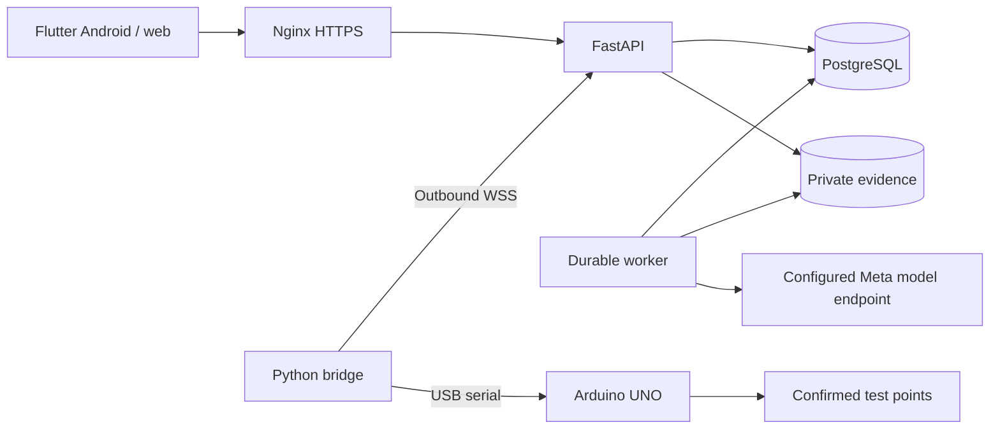

# CircuitLab AI

An evidence-driven assistant for troubleshooting low-voltage electronic circuits.
CircuitLab combines circuit photos, confirmed connections and targeted measurements
to help a person understand a fault, perform a repair and verify the result.

The Android/web laboratory and public landing support **English and Spanish**.
The local preview runs in explicitly labeled simulation mode.

## What it does

- Organizes private investigations for LED/resistor circuits, resistive dividers and analog sensors.
- Combines photographs, confirmed connections and authorized test points with competing fault hypotheses.
- Explains the next useful measurement and the different outcomes predicted by each hypothesis.
- Records manual or instrumented readings, including their source and calibration identifier.
- Keeps the human operator in control of physical changes and checks fresh readings against fixed criteria.
- Exports an investigation as JSON or Markdown and supports authenticated, read-only reviewers.
- Provides account administration, session revocation and password recovery through Resend.
- Retains Android drafts and pending photos/measurements in a local SQLite outbox.
- Optionally creates bilingual Circuit Story summaries linked to the investigation's source records.

## Investigation workflow

1. Describe the intended behavior, observed symptoms and supply voltage.
2. Confirm connections, operating conditions and up to three test points with acceptable voltage ranges.
3. Attach circuit photographs and request analysis. The specification is frozen when analysis starts.
4. Review competing explanations, predicted outcomes and the proposed measurement or clarification.
5. Confirm the measurement conditions and record a manual reading or request an instrument reading.
6. Review the proposed intervention, disconnect power for wiring changes and confirm the action performed.
7. Restore the operating conditions and collect fresh readings for every specified point.
8. Run deterministic verification and review the resulting report and event history.

The model proposes diagnostic steps. The backend enforces state transitions and
computes the final voltage-range check independently from the model's explanation.

## Technologies and architecture

| Component | Location | Technologies and responsibility |
|---|---|---|
| Laboratory | `apps/client` | Flutter/Dart, Riverpod, GoRouter, Dio, Drift/SQLite and secure token storage; Android and web UI |
| Landing | `apps/landing` | HTML, CSS and JavaScript with English/Spanish catalogs and prerendered pages |
| API and worker | `services/backend` | Python, FastAPI, Pydantic, SQLAlchemy and Alembic; private evidence, accounts and durable diagnostic jobs |
| Database | Configured by `DATABASE_URL` | PostgreSQL for deployment; SQLite for local development with a single worker |
| Inference | `services/backend/app` | Meta-compatible multimodal inference through Meta Model API, Baseten or a self-hosted endpoint |
| Instrument bridge | `services/bridge` | Python, WebSockets and pyserial; outbound connection, USB acquisition and a durable command journal |
| Firmware | `firmware/instrument_node` | Arduino UNO, PlatformIO and ArduinoJson; ADC readings at TP1-TP3 |
| Contracts | `contracts` | Exported OpenAPI and hardware JSON schemas |
| Evaluation | `experiments` | Python harness comparing diagnostic strategies under the same observation budgets |
| Deployment | `infra` | Docker Compose, a backend image and an Nginx HTTPS configuration example |
| Automation | `.github/workflows`, `scripts` | GitHub Actions, pytest, Flutter tests, landing DOM checks and development utilities |



The worker uses leases and execution tokens to reject stale responses without
holding a database transaction during inference. Measurement idempotency keys and
the bridge journal prevent duplicate records and repeated command execution.
Evidence access is restricted to owners and authorized reviewers. Passwords use
scrypt; access, refresh and device credentials are stored as hashes.

## Run locally

Requirements: Python **3.12.10**, uv, Flutter **3.35.6** / Dart **3.9.2**.
Node **22** is needed for landing checks; PlatformIO is needed for firmware.
Dependency versions are recorded in the committed lockfiles.

From `services/backend`, prepare the database and start the API:

```powershell
uv sync --frozen
$env:APP_ENV = 'development'
$env:AI_MODE = 'simulation'
$env:DATABASE_URL = 'sqlite:///./circuitlab.db'
uv run alembic upgrade head
uv run python -m app.manage create-user --email laboratory@example.com --admin --language en
uv run uvicorn app.main:app --host 127.0.0.1 --port 8000
```

In another terminal, from `services/backend`, start the worker with the same settings:

```powershell
$env:APP_ENV = 'development'
$env:AI_MODE = 'simulation'
$env:DATABASE_URL = 'sqlite:///./circuitlab.db'
uv run python -m app.worker
```

From `apps/client`, run the web laboratory:

```powershell
flutter pub get --enforce-lockfile
flutter run -d chrome --web-port 8080 --dart-define=API_BASE_URL=http://localhost:8000/api/v1
```

API documentation: <http://localhost:8000/docs>.
Readiness endpoint: `GET /api/v1/health/ready`.

### Package the landing and laboratory

From the repository root:

```powershell
cd apps/client
flutter build web --base-href /app/ --no-web-resources-cdn --dart-define=API_BASE_URL=http://localhost:8000/api/v1
cd ../..
python scripts/build_site.py
```

Output: `build/site/`. The Spanish landing is at `/`, the English landing at
`/en/`, and the laboratory at `/app/`. Behind an Nginx proxy, build with
`--dart-define=API_BASE_URL=/api/v1` instead of the local absolute URL.

After installing dependencies and packaging the local build, the Windows launcher
starts an isolated simulation database, API, worker and static website:

```powershell
powershell -File scripts/dev.ps1
# Stop the registered development services:
powershell -File scripts/stop-dev.ps1
```

The packaged local website opens at <http://localhost:8080/en/>. Its development
administrator is `demo@circuitlab.local` / `CircuitLab-demo-2026`.
Android emulators use `http://10.0.2.2:8000/api/v1`; physical devices need a reachable
API. Android queues pending photos and measurements; web saving requires connectivity.

## Configuration

Use `.env.example` as the configuration reference. The root `.env` is loaded by
Docker Compose. For direct local runs, export the settings in each terminal or use
`services/backend/.env`, which is loaded from the backend working directory.
Keep the database, storage and inference settings consistent between API and worker.

### Model inference

```dotenv
AI_MODE=meta
META_PROVIDER=meta
META_API_BASE_URL=https://api.meta.ai/v1
META_API_KEY=YOUR_PRIVATE_KEY
META_REASONING_MODEL=YOUR_ENABLED_MODEL_ID
```

Provider profiles are `meta`, `baseten` and `self_hosted`. Baseten uses
`https://inference.baseten.co/v1`; a self-hosted profile uses its configured
compatible endpoint. Model identifiers must be available to the configured account.
The adapter submits text/images and validates a `submit_diagnosis` tool result or
equivalent JSON against the application schema. Provider failures remain explicit.

Set `AI_MODE=simulation` for the deterministic development fixture. It performs no
model inference and labels its outputs as simulated. Changing the display language
does not issue a new inference request: model responses retain both translations.

### Accounts and Resend

Administrators create and manage accounts from the laboratory's Users panel.
Role/status changes revoke sessions; deactivation also revokes device credentials.
There is no public registration endpoint.

```dotenv
RECOVERY_DELIVERY=resend
APP_ORIGIN=https://YOUR_DOMAIN
RESEND_API_KEY=YOUR_RESEND_API_KEY
RESEND_FROM="CircuitLab AI <access@YOUR_VERIFIED_DOMAIN>"
```

Recovery links are expiring and single-use. Resetting a password revokes existing
sessions. The local launcher defaults to private email files; to exercise Resend,
configure the key and verified sender, then run
`powershell -File scripts/dev.ps1 -RecoveryDelivery resend`.

### Circuit Story

The optional story feature creates a bilingual visual summary after an investigation
reaches `resolved` or `inconclusive`. Its panels reference recorded observations,
measurements, interventions and verification results.

Configure `STORYBOARD_MODE=meta`, `STORYBOARD_API_KEY` and `STORYBOARD_MODEL` with an
available Muse Wonder model. The story key is independent from the diagnostic key.
`disabled` is the default; the local launcher can provide a labeled simulation preview.

## Hardware

The reference instrument uses an Arduino UNO with **TP1 -> A0, TP2 -> A1,
TP3 -> A2** and confirmed common GND. Firmware accepts JSON commands at 115200 baud
and averages 1-100 ADC samples. Supported measurements are DC voltages within the
instrument's documented 0-5 V range. It does not switch outputs or move probes.

Build and upload from `firmware/instrument_node` with `pio run` and
`pio run -t upload`. Set `ADC_REFERENCE_V` to the measured board reference and
validate each channel before using real readings; the default 5.0 V is nominal.

Enroll a device in the application and copy
`services/bridge/credentials.example.json` to a private `credentials.json`.
Configure its device ID/token, calibration ID, serial port and WebSocket URL.
From `services/bridge`:

```powershell
uv sync --frozen
$env:BRIDGE_CONFIG = 'credentials.json'
uv run python -m bridge.main
```

The bridge initiates the outbound connection and requires WSS outside localhost.
Its example configuration uses simulation. Real readings require calibrated hardware
and `simulate: false`. Timeouts, saturation and disconnected instruments produce
explicit failures. The SQLite command journal prevents automatic reacquisition after
disconnects or restarts.

## Development checks

Run the following commands from the indicated directories:

| Directory | Commands |
|---|---|
| `services/backend` | `uv run pytest -q` and `uv run ruff check .` |
| `services/bridge` | `uv sync --frozen` and `uv run pytest -q` |
| `apps/client` | `flutter analyze` and `flutter test` |
| `apps/landing` | After packaging the site: `npm ci --ignore-scripts --no-audit --no-fund` and `npm test` |

The suites cover the investigation workflow, account recovery/revocation, private
evidence, worker leases, hardware protocols, migrations, bilingual UI and landing
behavior. GitHub Actions runs the configured checks; tests remain in the repository
for regression verification and are not part of the application builds.

Maintain Flutter text in `apps/client/lib/l10n/app_en.arb` and `app_es.arb`, then run
`python scripts/generate_localizations.py`. Landing catalogs live in
`apps/landing/locales/`. Export API/hardware contracts with
`uv run python ../../scripts/export_contracts.py` from `services/backend`.

The evaluation harness compares initial-only, free-question, fixed-test and structured
hypothesis strategies. Its plan is `experiments/plan.v1.json`. It replays observations
under matched budgets; synthetic runs check the harness rather than physical repairs.

## Deployment and current limits

`infra/compose.yaml` defines PostgreSQL, migrations, API and a separate worker.
Configure the root `.env` with a strong database password, the matching PostgreSQL
`DATABASE_URL`, `APP_ENV=production`, `AI_MODE=meta`, an HTTPS `APP_ORIGIN`, and the
model/Resend credentials. Start with:

```powershell
docker compose --env-file .env -f infra/compose.yaml up -d --build
```

Serve `build/site/` through Nginx using `infra/nginx/circuitlab.conf.example` as a
reference. The API binds to loopback; private evidence is shared with the worker.
Back up PostgreSQL and its corresponding evidence files together.

The numerical verifier checks post-intervention voltage ranges. Temporal stability,
LED brightness, resistance, continuity, arbitrary circuits and multiple simultaneous
faults are outside the current scope. Simulation has been exercised locally; live
model inference, real Resend delivery, calibrated hardware, physical-device behavior
and production deployment still require validation in their configured environments.
