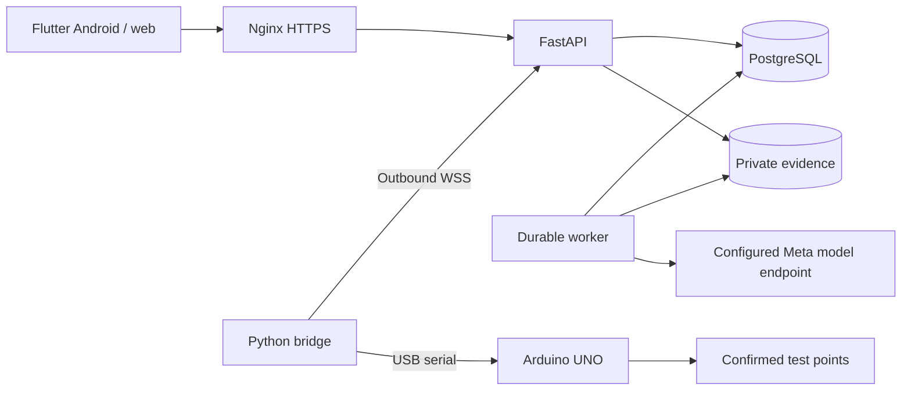

# CircuitLab AI

An evidence-driven assistant for troubleshooting low-voltage electronic circuits.
CircuitLab combines circuit photos, confirmed connections and targeted measurements
to help a person understand a fault, perform a repair and verify the result.

The Android/web laboratory and public landing support **English and Spanish**.
The local preview runs in explicitly labeled simulation mode.

## What it does

- Organizes private investigations for LED/resistor circuits, resistive dividers and analog sensors.
- Combines photographs, confirmed connections and authorized test points with competing fault hypotheses.
- Explains the next useful measurement and the different outcomes predicted by each hypothesis.
- Records manual or instrumented readings, including their source and calibration identifier.
- Keeps the human operator in control of physical changes and checks fresh readings against fixed criteria.
- Exports an investigation as JSON or Markdown and supports authenticated, read-only reviewers.
- Provides account administration, session revocation and password recovery through Resend.
- Retains Android drafts and pending photos/measurements in a local SQLite outbox.
- Optionally creates bilingual Circuit Story summaries linked to the investigation's source records.

## Investigation workflow

1. Describe the intended behavior, observed symptoms and supply voltage.
2. Confirm connections, operating conditions and up to three test points with acceptable voltage ranges.
3. Attach circuit photographs and request analysis. The specification is frozen when analysis starts.
4. Review competing explanations, predicted outcomes and the proposed measurement or clarification.
5. Confirm the measurement conditions and record a manual reading or request an instrument reading.
6. Review the proposed intervention, disconnect power for wiring changes and confirm the action performed.
7. Restore the operating conditions and collect fresh readings for every specified point.
8. Run deterministic verification and review the resulting report and event history.

The model proposes diagnostic steps. The backend enforces state transitions and
computes the final voltage-range check independently from the model's explanation.

## Technologies and architecture

| Component | Location | Technologies and responsibility |
|---|---|---|
| Laboratory | `apps/client` | Flutter/Dart, Riverpod, GoRouter, Dio, Drift/SQLite and secure token storage; Android and web UI |
| Landing | `apps/landing` | HTML, CSS and JavaScript with English/Spanish catalogs and prerendered pages |
| API and worker | `services/backend` | Python, FastAPI, Pydantic, SQLAlchemy and Alembic; private evidence, accounts and durable diagnostic jobs |
| Database | Configured by `DATABASE_URL` | PostgreSQL for deployment; SQLite for local development with a single worker |
| Inference | `services/backend/app` | Meta-compatible multimodal inference through Meta Model API, Baseten or a self-hosted endpoint |
| Instrument bridge | `services/bridge` | Python, WebSockets and pyserial; outbound connection, USB acquisition and a durable command journal |
| Firmware | `firmware/instrument_node` | Arduino UNO, PlatformIO and ArduinoJson; ADC readings at TP1-TP3 |
| Contracts | `contracts` | Exported OpenAPI and hardware JSON schemas |
| Evaluation | `experiments` | Python harness comparing diagnostic strategies under the same observation budgets |
| Deployment | `infra` | Docker Compose, a backend image and an Nginx HTTPS configuration example |
| Automation | `.github/workflows`, `scripts` | GitHub Actions, pytest, Flutter tests, landing DOM checks and development utilities |



The worker uses leases and execution tokens to reject stale responses without
holding a database transaction during inference. Measurement idempotency keys and
the bridge journal prevent duplicate records and repeated command execution.
Evidence access is restricted to owners and authorized reviewers. Passwords use
scrypt; access, refresh and device credentials are stored as hashes.

## Run locally

Requirements: Python **3.12.10**, uv, Flutter **3.35.6** / Dart **3.9.2**.
Node **22** is needed for landing checks; PlatformIO is needed for firmware.
Dependency versions are recorded in the committed lockfiles.

From `services/backend`, prepare the database and start the API:

```powershell
uv sync --frozen
$env:APP_ENV = 'development'
$env:AI_MODE = 'simulation'
$env:DATABASE_URL = 'sqlite:///./circuitlab.db'
uv run alembic upgrade head
uv run python -m app.manage create-user --email laboratory@example.com --admin --language en
uv run uvicorn app.main:app --host 127.0.0.1 --port 8000
```

In another terminal, from `services/backend`, start the worker with the same settings:

```powershell
$env:APP_ENV = 'development'
$env:AI_MODE = 'simulation'
$env:DATABASE_URL = 'sqlite:///./circuitlab.db'
uv run python -m app.worker
```

From `apps/client`, run the web laboratory:

```powershell
flutter pub get --enforce-lockfile
flutter run -d chrome --web-port 8080 --dart-define=API_BASE_URL=http://localhost:8000/api/v1
```

API documentation: <http://localhost:8000/docs>.
Readiness endpoint: `GET /api/v1/health/ready`.

### Package the landing and laboratory

From the repository root:

```powershell
cd apps/client
flutter build web --base-href /app/ --no-web-resources-cdn --dart-define=API_BASE_URL=http://localhost:8000/api/v1
cd ../..
python scripts/build_site.py
```

Output: `build/site/`. The Spanish landing is at `/`, the English landing at
`/en/`, and the laboratory at `/app/`. Behind an Nginx proxy, build with
`--dart-define=API_BASE_URL=/api/v1` instead of the local absolute URL.

After installing dependencies and packaging the local build, the Windows launcher
starts an isolated simulation database, API, worker and static website:

```powershell
powershell -File scripts/dev.ps1
# Stop the registered development services:
powershell -File scripts/stop-dev.ps1
```

The packaged local website opens at <http://localhost:8080/en/>. Its development
administrator is `demo@circuitlab.local` / `CircuitLab-demo-2026`.
Android emulators use `http://10.0.2.2:8000/api/v1`; physical devices need a reachable
API. Android queues pending photos and measurements; web saving requires connectivity.

## Configuration

Use `.env.example` as the configuration reference. The root `.env` is loaded by
Docker Compose. For direct local runs, export the settings in each terminal or use
`services/backend/.env`, which is loaded from the backend working directory.
Keep the database, storage and inference settings consistent between API and worker.

### Model inference

```dotenv
AI_MODE=meta
META_PROVIDER=meta
META_API_BASE_URL=https://api.meta.ai/v1
META_API_KEY=YOUR_PRIVATE_KEY
META_REASONING_MODEL=YOUR_ENABLED_MODEL_ID
```

Provider profiles are `meta`, `baseten` and `self_hosted`. Baseten uses
`https://inference.baseten.co/v1`; a self-hosted profile uses its configured
compatible endpoint. `META_API_KEY` belongs to the selected inference provider:
use a Baseten key with `META_PROVIDER=baseten`, not a Meta Model API key.
Model identifiers must be available to the configured account.
Each live diagnostic step uses a bounded two-request tool cycle. The model first
calls `get_recorded_observations`; the backend executes this read-only function for
the current authorized investigation and returns its recorded criteria/readings as
a `tool` message. The model then submits a bilingual `submit_diagnosis` result,
which the backend validates before changing session state. This tool cannot query
another session, acquire measurements, execute code or perform repairs.

`META_REASONING_EFFORT=low` bounds reasoning within the response budget. The API key
uses a redacted settings type and is sent only in backend authorization headers.
Every provider exchange and tool execution is audited in PostgreSQL, including
request hashes, receipts, reported model, usage and failures. Permanent provider
errors such as 401/403/404 are not retried automatically. No model fallback is selected.
Meta Model API uses its enabled hosted model IDs, such as `muse-spark-1.3`;
provider-hosted Muse Spark Open requires the corresponding provider's credentials
and exact model ID.

Set `AI_MODE=simulation` for the deterministic development fixture. It performs no
model inference and labels its outputs as simulated. Changing the display language
does not issue a new inference request: model responses retain both translations.

### Accounts and Resend

Administrators create and manage accounts from the laboratory's Users panel.
Role/status changes revoke sessions; deactivation also revokes device credentials.
There is no public registration endpoint.

```dotenv
RECOVERY_DELIVERY=resend
APP_ORIGIN=https://YOUR_DOMAIN
RESEND_API_KEY=YOUR_RESEND_API_KEY
RESEND_FROM="CircuitLab AI <access@YOUR_VERIFIED_DOMAIN>"
```

Resend is the only email provider; `RESEND_API_KEY` is separate from model credentials.
Recovery links are expiring and single-use. Resetting a password revokes existing
sessions. `disabled` turns delivery off; `file` previews messages in development
without sending email. The local launcher defaults to private email files; to exercise Resend,
configure the key and verified sender, then run
`powershell -File scripts/dev.ps1 -RecoveryDelivery resend`.

### Circuit Story

The optional story feature creates a bilingual visual summary after an investigation
reaches `resolved` or `inconclusive`. Its panels reference recorded observations,
measurements, interventions and verification results.

Configure `STORYBOARD_MODE=meta`, `STORYBOARD_API_KEY` and `STORYBOARD_MODEL` with an
available Muse Wonder model. `STORYBOARD_API_KEY` authenticates directly with Meta
Model API and is only needed for real story generation. Leave it empty with
`STORYBOARD_MODE=disabled` when using diagnosis alone. A Baseten diagnostic key does
not authenticate this endpoint. The local launcher can provide a labeled simulation preview.

## Hardware

The reference instrument uses an Arduino UNO with **TP1 -> A0, TP2 -> A1,
TP3 -> A2** and confirmed common GND. Firmware accepts JSON commands at 115200 baud
and averages 1-100 ADC samples. Supported measurements are DC voltages within the
instrument's documented 0-5 V range. It does not switch outputs or move probes.

Build and upload from `firmware/instrument_node` with `pio run` and
`pio run -t upload`. Set `ADC_REFERENCE_V` to the measured board reference and
validate each channel before using real readings; the default 5.0 V is nominal.

Enroll a device in the application and copy
`services/bridge/credentials.example.json` to a private `credentials.json`.
Configure its device ID/token, calibration ID, serial port and WebSocket URL.
From `services/bridge`:

```powershell
uv sync --frozen
$env:BRIDGE_CONFIG = 'credentials.json'
uv run python -m bridge.main
```

The bridge initiates the outbound connection and requires WSS outside localhost.
Its example configuration uses simulation. Real readings require calibrated hardware
and `simulate: false`. Timeouts, saturation and disconnected instruments produce
explicit failures. The SQLite command journal prevents automatic reacquisition after
disconnects or restarts.

The adapters are separate modules under `services/bridge/bridge/adapters/`:
`SimulatedAdapter` requires `simulate: true` and an explicit finite 0-5 V fixture
value for each requested point. `SerialAdapter` requires `simulate: false` and
never falls back to fixture values after a hardware failure. The server checks that
the result source matches the device's enrollment mode.

### First real instrument test

1. Connect an Arduino UNO and identify its actual serial port. Measure the board's
   ADC reference, set `ADC_REFERENCE_V`, build/upload the reference firmware, and
   compare channel readings against a reference meter. Record a calibration ID.
2. Use a supported 0-5 V DC circuit, confirm common GND, and connect only the
   authorized test points: TP1/A0, TP2/A1, TP3/A2. The instrument does not move probes.
3. Start the Docker API and worker with `AI_MODE=meta` and matching provider settings:
   `docker compose --env-file .env -f infra/compose.yaml up -d --build api worker`.
   Create a laboratory account if needed using
   `docker compose --env-file .env -f infra/compose.yaml run --rm --no-deps migrate python -m app.manage create-user --email laboratory@example.com --admin --language en`.
   The command prompts for a password; no password is placed in shell arguments.
4. Enroll the device with simulation disabled. Put its returned device ID/token,
   calibration ID and serial port in the ignored `services/bridge/credentials.json`.
   Set `simulate: false`, remove `simulated_values`, and use
   `ws://127.0.0.1:8000/api/v1/devices/connect` locally or WSS remotely.
5. Run the bridge using the commands above. Create a new real investigation, confirm
   its criteria, upload actual circuit photographs, and request analysis. When the
   model requests a measurement, confirm the conditions and request the instrument.
6. Check that the stored result has `source: instrumented`, the expected calibration
   ID and a fresh acquisition time. A timeout/disconnect is a failed check, never zero.
   Record any physical intervention only after it was performed. Functional
   verification requires fresh post-intervention readings at every specified point;
   simulated readings cannot establish `physical_verification: true`.

## Administrator metrics

Administrators have a Metrics section beside user administration. The web and
Android interface offers English/Spanish labels, 7/30/90-day filters, real versus
simulation filters, and interactive daily charts for requests, tokens and latency.

`GET /api/v1/admin/metrics` requires an active administrator and returns no-store
responses containing only operational fields. It aggregates PostgreSQL audit data;
opening or refreshing the panel never calls the model. Raw prompts, images,
provider response bodies and service credentials are excluded.

The dashboard reports network requests, HTTP outcomes, p95 latency, reported input
and output tokens, accepted diagnostic steps, failed attempts, authorized tool
executions, current job backlog, measurement sources and session states. Network
exchanges are counted once; diagnostic summaries and nested copies of receipts are
excluded. Missing token usage or timing stays unknown. Daily buckets use UTC;
recent-call timestamps are displayed in the viewer's local time. Session charts
show the current state of sessions created during the selected period; the queue
shows current pending/running jobs regardless of their creation date.

HTTP success and schema acceptance are operational metrics, not diagnostic accuracy.
Accuracy remains unavailable until independently reviewed labeled cases are linked.
Real inference can consume simulated instrument readings; their source labels are
preserved and are shown separately from physical verification.

## Live provider verification

This opt-in check makes paid requests to the configured real Meta/Baseten endpoint;
it never substitutes model fixtures. Run it from the repository root after setting
`APP_ENV=development`, `AI_MODE=meta`, valid provider credentials and the matching
PostgreSQL URL. The simulated bench is deliberately unavailable in production;
use actual hardware for a production investigation:

```powershell
docker compose --env-file .env -f infra/compose.yaml up -d --wait postgres
docker compose --env-file .env -f infra/compose.yaml build migrate
docker compose --env-file .env -f infra/compose.yaml run --rm --no-deps migrate
docker compose --env-file .env -f infra/compose.yaml run --rm --no-deps -v "${PWD}/services/bridge/bridge:/app/bridge:ro" migrate python -m app.verify_live
```

The verifier exercises the actual FastAPI handlers in process, PostgreSQL and real
remote inference. It checks text, a synthetic image, an executed/returned observation
tool, and a complete diagnostic update after a simulated instrument result carried
over the authenticated WebSocket protocol. It does not verify a public deployment,
a real circuit photograph or a physical repair. The temporary verification account
is disabled and its sessions/device credentials revoked after the check.

The synthetic schematic is labeled as such. Image files stay in the private evidence
volume; their metadata and SHA-256 hashes, hypotheses, measurements, model/tool
receipts and state transitions are stored in PostgreSQL. The session stays open for
further checks and no intervention or functional verification is fabricated.
Use `--resume-session SESSION_ID` to retry a verifier-owned pending session; passed
text/image probes reuse their stored real receipts. Completed checks need a new run.
`/health/live` reports configuration presence, not provider connectivity.

## Development checks

Run the following commands from the indicated directories:

| Directory | Commands |
|---|---|
| `services/backend` | `uv run pytest -q` and `uv run ruff check .` |
| `services/bridge` | `uv sync --frozen` and `uv run pytest -q` |
| `apps/client` | `flutter analyze` and `flutter test` |
| `apps/landing` | After packaging the site: `npm ci --ignore-scripts --no-audit --no-fund` and `npm test` |

The suites cover the investigation workflow, account recovery/revocation, private
evidence, worker leases, hardware protocols, migrations, bilingual UI and landing
behavior. GitHub Actions runs the configured checks; tests remain in the repository
for regression verification and are not part of the application builds.

Maintain Flutter text in `apps/client/lib/l10n/app_en.arb` and `app_es.arb`, then run
`python scripts/generate_localizations.py`. Landing catalogs live in
`apps/landing/locales/`. Export API/hardware contracts with
`uv run python ../../scripts/export_contracts.py` from `services/backend`.

The evaluation harness compares initial-only, free-question, fixed-test and structured
hypothesis strategies. Its plan is `experiments/plan.v1.json`. It replays observations
under matched budgets; synthetic runs check the harness rather than physical repairs.

## Deployment and current limits

`infra/compose.yaml` defines PostgreSQL, migrations, API and a separate worker.
The `circuitlab-meta` Compose project uses its own containers, image and named volumes.
Configure the root `.env` with a strong database password, the matching PostgreSQL
`DATABASE_URL`, `APP_ENV=production`, `AI_MODE=meta`, an HTTPS `APP_ORIGIN`, and the
model/Resend credentials. Start with:

```powershell
docker compose --env-file .env -f infra/compose.yaml up -d --build
```

Serve `build/site/` through Nginx using `infra/nginx/circuitlab.conf.example` as a
reference. The API binds to loopback; private evidence is shared with the worker.
Back up PostgreSQL and its corresponding evidence files together.

The numerical verifier checks post-intervention voltage ranges. Temporal stability,
LED brightness, resistance, continuity, arbitrary circuits and multiple simultaneous
faults are outside the current scope. Simulation has been exercised locally; the
live verifier checks configured model inference separately. Real Resend delivery, calibrated hardware, physical-device behavior
and production deployment still require validation in their configured environments.

## Shared Linux VPS deployment

The production domain is `circuitlab.doc-ia.cloud`. The landing is served at
`https://circuitlab.doc-ia.cloud/`, the bilingual application at
`https://circuitlab.doc-ia.cloud/app/`, and the API at
`https://circuitlab.doc-ia.cloud/api/v1`. Device bridges connect to
`wss://circuitlab.doc-ia.cloud/api/v1/devices/connect`.

The prepared target is `/var/www/circuitlab`, with host Nginx/Certbot and an isolated
Docker Compose stack for API, worker, migrations and PostgreSQL. Docker Engine and
the Compose plugin must be available. The preparation helpers require Python 3.9+. Node/PM2 are not used for these services.
PostgreSQL has no published host port; only the API is published on loopback.

The production override keeps application containers non-root, read-only outside
the evidence volume and temporary directory, and drops extra Linux capabilities.
It forces real inference and disables Circuit Story. Proxy headers are trusted
because this API port is bound exclusively to loopback for the host Nginx proxy.

### Prepare configuration for the production domain

Put this repository in its dedicated server directory. From that directory:

```bash
python3 scripts/prepare_vps.py --domain circuitlab.doc-ia.cloud --root /var/www/circuitlab --api-port 8014
```

Choose an unused local API port; 8014 is a configurable example. Generated files
are placed in ignored `.tools/vps/`: `runtime.env`, an HTTP certificate-challenge
site, and the HTTPS site. The generator creates a private database password,
leaves Meta/Resend keys empty, and refuses to overwrite existing generated files.
It never reads or copies development credentials and never contacts the VPS.

On the VPS, install the reviewed environment as the project's `.env`, with mode
600. Fill Meta and Resend credentials privately; set a verified `RESEND_FROM`.
Update provider/model fields together if using a different inference provider.
Use `RECOVERY_DELIVERY=disabled` only when recovery is deliberately unavailable.
`APP_ORIGIN` must be `https://circuitlab.doc-ia.cloud` (without `/app/` or
`/api/v1`). The web build uses the relative `/api/v1` URL, so frontend requests
remain on the same HTTPS origin. Preserve the existing database
password on updates; changing an environment file does not reset PostgreSQL.

### Build and check only CircuitLab

From `/var/www/circuitlab`:

```bash
cd apps/client
flutter pub get --enforce-lockfile
flutter build web --base-href /app/ --no-web-resources-cdn --dart-define=API_BASE_URL=/api/v1
cd ../..
python3 scripts/build_site.py
python3 scripts/deploy_vps.py --check
```

Alternatively, build with the pinned Flutter SDK locally and upload `build/site/`;
do not upgrade a shared server SDK as part of this deployment.

The check validates environment structure without printing credentials. It does
not contact Meta or verify provider access. Example domains and missing keys are
rejected. Review the generated files before applying them.

```bash
python3 scripts/deploy_vps.py --apply
```

Apply runs only on Linux from the configured project directory. It checks Compose
resource ownership, refuses an occupied API port and images belonging to another
project, and refuses orphaned project volumes until ownership is reviewed.
It builds the dedicated image, starts its PostgreSQL, writes a private custom-format
`pg_dump` backup under `.tools/backups/`, applies migrations, and starts only its API
and worker. No volumes are deleted. Docker output containing interpolated values is
not printed. Back up the evidence volume alongside the database for recovery.

The script does not install Docker, modify Nginx, obtain certificates, stop other
projects or issue global PM2 commands. Existing Nginx configuration must be reviewed
separately. No remote server changes are made by configuration preparation.

### Activate the domain through the existing Nginx

1. Point the DNS record for `circuitlab.doc-ia.cloud` at the VPS. Check that no existing site owns that
   hostname and that CircuitLab's proposed site filenames are unused.
2. Create `/var/www/circuitlab/.acme`. Install the generated HTTP-only configuration
   as a separate CircuitLab site in the host's existing Nginx site mechanism.
   It exposes only the ACME challenge path, keeping application HTTP unavailable.
3. Validate with `sudo nginx -t`, then gracefully reload Nginx after reviewing the
   added site. Existing project configurations are not edited or restarted.
4. Obtain only this domain's certificate:
   `sudo certbot certonly --webroot -w /var/www/circuitlab/.acme -d circuitlab.doc-ia.cloud`.
   The webroot method does not rewrite existing Nginx sites.
5. Replace only CircuitLab's HTTP site with the generated HTTPS site after confirming
   its certificate paths. Run `sudo nginx -t` again before a graceful reload.
6. Create the first administrator interactively:
   `docker compose --env-file .env -f infra/compose.yaml -f infra/compose.production.yaml run --rm --no-deps migrate python -m app.manage create-user --email YOUR_EMAIL --admin --language en`.
   The password is prompted privately, never passed as a command-line argument.
7. Verify `/api/v1/health/ready`, both landing languages, login, administrator metrics,
   uploads, and the device WebSocket through HTTPS/WSS. Metrics must remain 401/403
   without administrator access. No public database port should exist.

DNS/TLS, SSH destination, VPS Docker availability, credentials and
production connectivity still require validation on the actual server.
