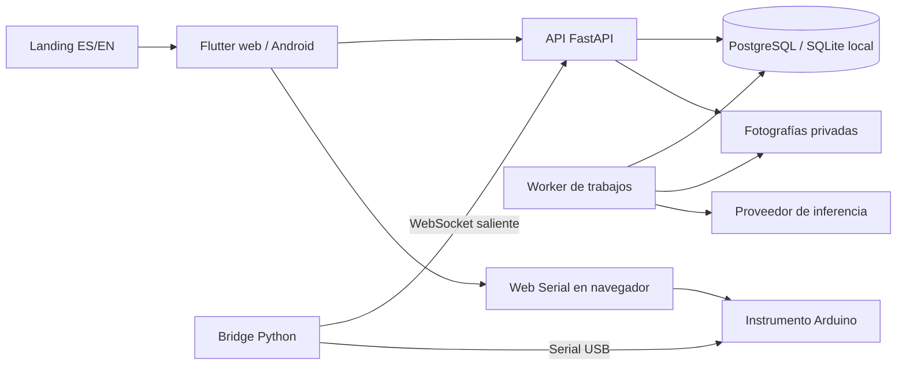

# Revisión de CircuitLab AI

Fecha: 29 de octubre de 2026. Código de referencia: `4e4f96b`.

## Alcance y resultado

Se inventariaron los 244 archivos versionados y se revisaron la arquitectura, los flujos principales, los modelos de datos, la inferencia, la instrumentación, el almacenamiento local, los contratos, las migraciones, la evaluación y la automatización de despliegue. El inventario contiene aproximadamente 31.566 líneas de texto, incluyendo contratos, documentación y archivos generados. Ese número no representa líneas revisadas individualmente ni cobertura de pruebas.

La revisión combina lectura del código y ejecución local. No se modificó la lógica de la aplicación. El entorno Python, las reproducciones y una copia de la landing quedaron en `.tools/`, que Git ignora. Se instalaron las dependencias de las pruebas de la landing en su `node_modules`, también ignorado.

El proyecto implementa un laboratorio de diagnóstico guiado con historial y criterios verificables. Tiene separación explícita entre simulación, observación humana y adquisición instrumental. La validación local encontró dos defectos reproducibles y fallos en la batería del backend; por tanto, esta revisión no certifica que todo esté funcionando.

## Qué problema resuelve

CircuitLab ayuda a investigar un circuito electrónico de 0–5 V DC. El usuario declara qué debería ocurrir, qué observa, las conexiones que confirmó y los puntos que está autorizado a medir. Puede aportar fotografías y lecturas. El sistema compara hipótesis, propone una observación siguiente y conserva la trazabilidad del proceso.

El operador realiza y confirma las modificaciones físicas. El backend comprueba los criterios eléctricos y una observación funcional independiente antes de aceptar una reparación. El estado `resolved` en simulación no equivale a una reparación física: el resultado conserva `physical_verification: false`.

El producto contempla cuatro familias: `led_resistor`, `voltage_divider`, `analog_sensor` y `digital_signal`. Tiene dos propósitos: `diagnosis`, que exige síntomas, y `check_operation`, que permite comprobar el funcionamiento sin presuponer una avería.

## Mapa del repositorio

| Carpeta | Función y archivos centrales |
|---|---|
| `apps/client` | Aplicación Flutter web/Android. Entrada en `lib/main.dart`; laboratorio en `lib/features/workbench.dart`; API y autenticación en `lib/core/networking/api.dart`. |
| `apps/landing` | Página pública bilingüe, navegación hacia el laboratorio y descarga de APK. HTML, CSS, JavaScript y catálogos ES/EN. |
| `services/backend` | API FastAPI, SQLAlchemy, migraciones Alembic, reglas del flujo, inferencia y worker. |
| `services/bridge` | Cliente Python de instrumentación por WebSocket, adaptadores serial/simulado y diario SQLite de comandos. Conserva código de escritorio Windows. |
| `firmware/instrument_node` | Firmware de instrumento Arduino UNO, compilable con PlatformIO. |
| `contracts` | OpenAPI exportado y esquemas JSON de comandos/resultados físicos. |
| `experiments` | Evaluador de estrategias de diagnóstico, generador sintético, contratos y puntuación separados. |
| `infra` | Docker Compose, imagen backend, plantillas Nginx y unidades systemd para monitorización y respaldos. |
| `scripts` | Desarrollo local, construcción pública, contratos, localización, empaquetado, despliegue y restauración de respaldos. |
| `releases/android` | APK distribuido y checksum. El empaquetado público prioriza este APK versionado. |
| `.github/workflows/ci.yml` | Pruebas, compilaciones, artefacto público y despliegue condicionado a configuración de GitHub. |

## Arquitectura y recorrido de una operación

La API persiste la petición de análisis como un trabajo. El worker reclama ese trabajo, obtiene una instantánea de la investigación, realiza la inferencia fuera de la transacción larga y valida la respuesta antes de guardarla. Los trabajos tienen vencimiento de reserva y un token de ejecución para descartar respuestas de una ejecución anterior.

La cola reside en la base de datos; no hay Redis o Celery en las dependencias declaradas. PostgreSQL usa bloqueos de filas y `skip_locked`. El uso local de SQLite está documentado para un solo worker.

## Flujo funcional completo

1. Crear una cuenta de miembro mediante registro público o acceder con una cuenta existente. Un administrador también puede crear cuentas y gestionar sus roles.
2. Crear la investigación con familia, propósito, comportamiento esperado, síntomas cuando correspondan y alimentación declarada.
3. Confirmar conexiones, prueba funcional y entre uno y ocho puntos. Cada punto usa un intervalo de voltaje o un estado booleano esperado.
4. Adjuntar fotografías opcionales y solicitar análisis. Se bloquea la edición de criterios durante el análisis y después de un análisis completado.
5. El modelo propone otra vista, una confirmación de conexión, una lectura, una intervención o un resultado inconcluso.
6. Registrar la lectura manual o instrumental del punto solicitado. Esto encola la continuación del análisis.
7. Si corresponde intervenir, la persona registra y confirma lo que hizo. Comienza la fase `verifying`.
8. Obtener lecturas posteriores a la intervención de todos los puntos y registrar por separado el resultado observado de la prueba funcional.
9. Solicitar verificación. El worker compara valores con los criterios fijados y termina como `resolved` o `inconclusive`.
10. Sin intervención, una investigación con lecturas adecuadas puede pasar a comprobación funcional y terminar en `no_fault_found`. El cierre voluntario termina en `cancelled` sin declarar una reparación.

Los estados y permisos están centralizados principalmente en `app/domain.py`. `app/completion.py`, `app/measurements.py`, `app/operations.py` y `app/worker.py` determinan la preparación y el resultado de las comprobaciones.

## Datos, permisos y trazabilidad

`app/db.py` define usuarios, sesiones de autenticación, tokens, investigaciones, lectores invitados, fotografías, mediciones, hipótesis, intervenciones, verificaciones, eventos, trabajos, ejecuciones del modelo, historias, instrumentos, conexiones USB y comandos.

Cada investigación tiene propietario, versión, especificación confirmada, modo de diagnóstico y prueba pendiente. Los eventos llevan secuencia única por investigación. Las mediciones y fotografías usan identificadores del cliente para evitar duplicados al reenviar datos.

Los voltajes se guardan en una columna numérica; los estados digitales, en una columna Boolean separada. La API devuelve un campo `value` tipado. `false` se conserva como observación válida y no se convierte en 0 V.

Las contraseñas usan scrypt. Los tokens de acceso, renovación e instrumentos se almacenan como hashes. La web conserva la renovación en una cookie HttpOnly; Android utiliza almacenamiento seguro. La actividad humana renueva el plazo de inactividad, mientras que el polling no lo prolonga. La configuración predeterminada permite cuatro horas sin actividad.

Los lectores invitados pueden consultar investigaciones autorizadas, pero no modificarlas. Las rutas de administración exigen rol de administrador. La recuperación usa tokens de un solo uso y admite Resend o archivos de desarrollo; sus respuestas públicas son genéricas.

Las fotos se validan como JPEG/PNG, se limita su tamaño y resolución, y se recodifican antes de almacenarlas. Su descarga exige autorización. Retirar una foto revoca su acceso y elimina el archivo vivo conservando metadatos de auditoría. Si ya hubo análisis, invalida las hipótesis actuales y devuelve la investigación a revisión; se bloquea la retirada mientras hay trabajos activos.

## Cómo interviene la IA

`app/meta.py` construye el contexto con especificación, fotografías activas, lecturas, hipótesis anteriores válidas y confirmaciones. El prompt ordena tratar textos e imágenes del usuario como evidencia y limita las acciones al alcance autorizado.

La inferencia real utiliza un ciclo acotado de dos solicitudes: primero una llamada sin argumentos a `get_recorded_observations`; después, la devolución de ese resultado al modelo y la solicitud de `submit_diagnosis`. La herramienta de lectura no adquiere mediciones ni permite elegir otra investigación.

Se exige salida bilingüe alineada. Para solicitar una medición, la validación real exige hipótesis competidoras y predicciones asociadas. El backend rechaza referencias a evidencia inexistente, puntos no autorizados, tipos de lectura incompatibles e intervenciones sin medición citada. El contenido de una explicación sigue siendo una propuesta del modelo; estas validaciones no demuestran que su razonamiento electrónico sea correcto.

`app/inference.py` implementa perfiles `meta`, `baseten` y `self_hosted`, valida las URL y exige credencial y modelo configurados. No selecciona un modelo alternativo silenciosamente. Registra solicitudes y respuestas con campos de auditoría y redacción de la credencial. Los errores permanentes de proveedor no se reintentan automáticamente; otros fallos tienen reintentos limitados.

El modo `simulation` ejecuta una rutina determinista de prueba, sin inferencia. Producción exige PostgreSQL y modo `meta`. Los límites predeterminados son ocho pasos de análisis, veinte intentos diarios por usuario y doscientos globales. Son presupuestos de intentos, no límites monetarios exactos.

Circuit Story es una función opcional retrospectiva. Genera paneles bilingües estructurados con referencias a registros de la investigación. La implementación revisada trabaja con títulos, textos y fuentes; no contiene una canalización de generación de imágenes raster para esos paneles.

## Instrumentación y límites físicos

El firmware de referencia utiliza Arduino UNO y mapea `TP1→A0`, `TP2→A1`, `TP3→A2`, a 115200 baudios. La investigación admite ocho puntos declarados, pero eso no amplía los tres canales del instrumento.

`read_voltage` promedia muestras ADC, utiliza `ADC_REFERENCE_V` y rechaza saturación. `read_digital` exige que todas las muestras coincidan y devuelve un booleano. El instrumento no acciona salidas, mueve sondas, carga firmware ni inspecciona variables internas de otra placa automáticamente.

El navegador valida y envía únicamente comandos del protocolo fijo. Tiene tiempos máximos, protección frente a comandos repetidos y manejo de desconexión. El backend usa una reserva USB de quince segundos y un identificador de conexión para evitar resultados de otra pestaña o conexión anterior. La adquisición se detiene al ocultar la pestaña o perder la sesión.

El bridge Python ofrece una ruta adicional para instalaciones preparadas. Abre una conexión saliente y exige WSS fuera de localhost. Su diario SQLite reserva cada comando antes de adquirir datos y conserva el resultado para evitar repetir la adquisición. Los adaptadores real y simulado están separados; un fallo real no activa una lectura simulada de reemplazo.

Android no abre USB directamente en esta versión. Puede registrar datos manuales o pedir una lectura a un instrumento conectado por las otras rutas. El identificador de calibración es una referencia aportada por el operador, no una certificación automática de exactitud.

## Cliente, idiomas y funcionamiento sin conexión

Flutter utiliza Riverpod, GoRouter, Dio y componentes Material. Las rutas principales son laboratorio, registro, recuperación y restablecimiento de contraseña. La navegación pública conserva idioma e identificador de investigación.

El cliente consulta el progreso de la investigación aproximadamente cada cuatro segundos cuando está activo, ajusta la frecuencia de los listados y evita que una respuesta de una ruta anterior reemplace la investigación actual. El controlador USB vive en un proveedor compartido para sobrevivir a la navegación habitual.

En Android, Drift/SQLite conserva borradores y una cola de fotos/lecturas pendientes por cuenta y URL de API. La web guarda sus borradores en memoria y no ofrece esa cola persistente. No equivale a funcionamiento completamente autónomo sin servidor: crear sesiones y analizar requieren la API.

ES/EN se implementa mediante catálogos del cliente y de la landing, traducción de errores del backend y respuestas bilingües del modelo. Cambiar el idioma de visualización no necesita repetir la inferencia.

## Evaluación experimental

El evaluador compara cuatro métodos: información inicial, preguntas libres, pruebas fijas y procedimiento estructurado. Separa entradas públicas, observaciones disponibles y etiquetas reservadas al evaluador. Registra hashes, presupuestos, uso y trazas; mantiene los errores en el denominador y remuestrea montajes, no repeticiones como casos independientes.

El generador produce dieciocho casos sintéticos de tres familias. Con cuatro métodos y dos repeticiones, las pruebas ejercitan 144 ejecuciones. Esto valida la maquinaria experimental y no demuestra precisión clínica, eléctrica o científica del producto. El contrato experimental todavía se limita a voltajes, tres puntos y las tres familias originales; no cubre la nueva familia digital ni estados booleanos.

No se encontraron resultados experimentales físicos versionados dentro del inventario revisado. Los resultados privados podrían existir fuera de este checkout. No se hicieron llamadas pagadas al proveedor durante esta revisión.

## Despliegue y operación

Compose separa PostgreSQL, migración, API y worker, con volúmenes de datos y evidencia. La API se publica en loopback para Nginx. La configuración de producción ejecuta los servicios de aplicación con sistema de archivos de solo lectura, `/tmp` temporal, capacidades eliminadas y usuario sin privilegios en la imagen.

CI declara pruebas SQLite/PostgreSQL, inspección de migraciones, bridge, Flutter, protocolo USB, landing y compilación de firmware. El despliegue automático requiere push a `main`, controles aprobados, variable de activación y secretos del entorno `production`. Su existencia en YAML no demuestra que esté activado o que el último run haya pasado.

El artefacto público tiene manifiesto y checksums; el gateway valida revisión, rutas y contenidos y rechaza cambios locales o actualizaciones divergentes. Antes de migrar se realiza un dump de PostgreSQL. La publicación cambia el sitio mediante una referencia a la versión preparada y comprueba salud e identidad de la revisión.

Si falla la comprobación pública, se restaura la referencia al sitio anterior. No se revierte automáticamente la base de datos ni los contenedores backend. Los scripts de respaldo contemplan archivo de evidencia, manifiesto, ensayo de restauración aislado y copia externa opcional.

## Hallazgos concretos

### 1. Desconectar USB durante una lectura digital puede producir HTTP 500

Prioridad alta. Confirmado mediante API con base de datos aislada.

En `services/backend/app/browser_usb.py:31`, `fail_commands` construye un `HardwareResult` de desconexión sin indicar la unidad. El esquema usa `V` de forma predeterminada. En `app/main.py:919`, `accept_result` exige `boolean` cuando el comando es `read_digital`, incluso para un resultado de error.

Con un comando digital pendiente, desconectar produce `ValueError`, la API devuelve 500 y la transacción no finaliza el comando. La misma función se usa al reconectar tras una reserva vencida y al revocar un instrumento USB. La reproducción directa comprobó desconexión; las otras rutas comparten la causa por inspección del código.

Corrección sugerida: construir la unidad del resultado de fallo a partir de la acción del comando y cubrir desconexión/revocación/reconexión digital.

### 2. La precisión de fechas puede hacer desaparecer una lectura aceptada para verificación

Prioridad alta. Confirmado con un caso límite determinista en SQLite.

`app/db.py:31` convierte segundos epoch de tipo float a `datetime`, que tiene precisión de microsegundos. El umbral `pending_test.after` permanece como float dentro de JSON. Una lectura aceptada en el mismo instante representable del reloj puede volver de la base de datos ligeramente anterior al umbral: por ejemplo, una fracción `.1234562` se recupera como `.123456`.

`app/main.py:684` compara posteriormente ambas representaciones y considera que falta la lectura. La reproducción confirmó que el endpoint acepta la medición y después rechaza la verificación con 409. La conversión también puede redondear hacia arriba y afectar comparaciones de observaciones funcionales tomadas en el mismo instante.

La batería local mostró fallos variables en estos flujos entre ejecuciones. El caso determinista demuestra el defecto de precisión, pero no se instrumentó cada fallo de la batería para atribuirlos todos a esa causa.

Corrección sugerida: normalizar a una misma precisión los tiempos persistidos y los umbrales de comparación. Conservar la exigencia de lecturas recientes y añadir cobertura de los bordes de redondeo.

### 3. Documentación contradictoria sobre el producto actual

Prioridad media. Confirmado por comparación del README con el código y con otras secciones del propio README.

- `README.md:184` niega un endpoint de registro público, mientras `app/accounts.py:185` implementa `/auth/register` y el README lo describe después en la línea 503.
- El flujo inicial del README limita los puntos a tres; `Specification` admite ocho. El firmware sí conserva tres canales físicos.
- La introducción enumera las tres familias originales; `SessionCreate` incluye `digital_signal` y observaciones booleanas.
- Hay referencias de cliente a `0.1.16/build 17`; `apps/client/pubspec.yaml` declara `0.1.17+18`. Esto demuestra desfase documental; no se inspeccionó la versión interna del APK para afirmar que coincide con el código.

Conviene consolidar la descripción vigente y separar claramente alcance del producto, canales físicos y características de cada versión.

### 4. Una entrada pendiente rechazada puede bloquear la sincronización siguiente

Prioridad media, riesgo identificado por lectura; sin reproducción de Flutter en esta sesión.

`CircuitApi.sync()` procesa la cola secuencialmente y elimina una entrada solo después de enviarla con éxito. No distingue un conflicto permanente 409/422 de un fallo temporal ni ofrece aquí un mecanismo para apartar esa entrada. `Workbench.refresh()` espera a que termine esa sincronización antes de consultar el espacio de trabajo.

Una lectura almacenada sin conexión que ya no corresponda al estado del servidor podría impedir enviar entradas posteriores y también frenar ese refresco. Conviene ofrecer revisión o descarte explícito del elemento rechazado, sin perderlo automáticamente.

### 5. Puntos de concentración y alcance de las pruebas

`workbench.dart` concentra aproximadamente 2.742 líneas y `app/main.py`, 1.007. Son puntos sensibles para cambios que mezclen navegación, formularios y operaciones. Es una observación de mantenimiento, no un fallo demostrado ni una razón para reescribir el sistema.

El evaluador y el catálogo público de pruebas también requieren atención al incorporar lo digital: el snapshot del worker incluye procedimiento digital, mientras `/tests/catalog` devuelve únicamente el procedimiento de voltaje. No se comprobó un consumidor actual que dependa de que ese endpoint enumere ambos.

## Comprobaciones ejecutadas

| Comprobación | Resultado observado |
|---|---|
| Backend completo, ejecución final con Pydantic/core ajustados al lockfile | 273 aprobadas, 3 fallidas, 2 omitidas. |
| Backend completo, primera ejecución | 271 aprobadas, 5 fallidas, 2 omitidas. Tenía una versión patch posterior de Pydantic/core. |
| Bridge Python | 29 aprobadas. |
| Protocolo USB JavaScript | 28 aprobadas. |
| Landing generada en copia temporal y pruebas DOM | 7 aprobadas. |
| Ruff del backend y conjunto de scripts/evaluador incluido en CI | Sin errores. |
| Reproducciones adicionales en `.tools/review_checks.py` | 3 aprobadas: confirman el error digital, el redondeo de fechas y el rechazo posterior de una lectura aceptada. |

Fallos de la ejecución final del backend:

- `test_story_is_durable_bilingual_idempotent_and_never_changes_diagnosis`: verificación devuelve 409 donde espera 202.
- `test_story_access_readiness_and_configuration`: mismo punto de preparación de la investigación, antes de generar la historia.
- `test_functional_check_is_fresh_authorized_idempotent_and_retains_manual_basis`: verificación devuelve 409 donde espera 202.

Las reproducciones adicionales comprueban que los defectos existen; su aprobación no significa que estén corregidos. Los primeros intentos de pruebas restringidos fallaron por permisos temporales/procesos y no se contabilizaron como fallos del producto.

No estaban disponibles `flutter`, `dart`, `uv` o PlatformIO en PATH. Para Python se creó un entorno aislado con las dependencias declaradas y se ajustó Pydantic/core a las versiones del lockfile; no se ejecutó `uv sync --frozen`. La comparación final encontró dos diferencias frente al lock del backend: `tzdata` instalado 2026.6 frente a 2026.5 y `websockets` instalado 15.0.1 frente a 17.3; el bridge declara 15.0.1. `uvloop` no se instaló en Windows. Los resultados no sustituyen una ejecución exacta del entorno CI. No se ejecutaron Flutter analyze/test/build, compilación Android o firmware, pruebas PostgreSQL, inspección visual en navegador ni pruebas con instrumentos reales. La instalación editable con pip falló por descubrimiento de los paquetes `app` y `migrations`; el procedimiento oficial utiliza uv y no se considera ese intento una prueba de que falle la instalación documentada.

No se accedió al VPS, a secretos de producción, al estado real de GitHub Actions, a un buzón Resend ni al proveedor de inferencia. El informe distingue el comportamiento implementado y probado localmente de esas comprobaciones externas pendientes.

## Orden recomendado de trabajo

1. Corregir la unidad de los fallos USB digitales y normalizar las comparaciones temporales; incorporar las reproducciones como regresiones permanentes.
2. Conseguir una ejecución limpia del backend con el lockfile completo en SQLite y PostgreSQL.
3. Alinear README, familias, límites de puntos y versiones; ampliar evaluación/catálogo digital según el alcance que se quiera ofrecer.
4. Comprobar el manejo de conflictos de la cola Android y ejecutar las pruebas Flutter.
5. Validar el recorrido físico completo: calibración, lectura real, intervención humana, nuevas lecturas y observación funcional, seguido de un despliegue y restauración comprobados en su entorno.
